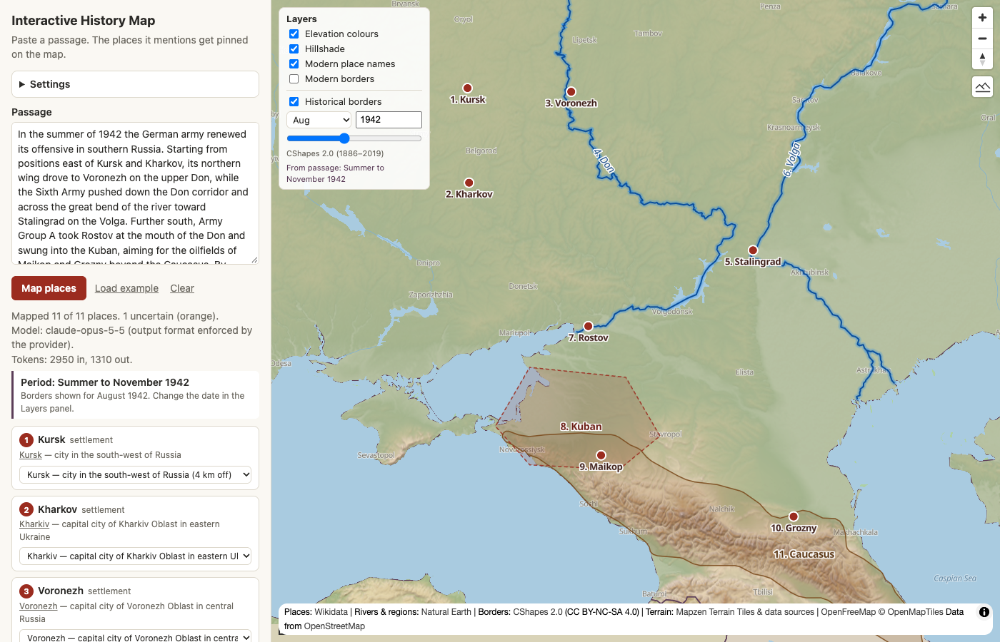

# Interactive History Map

**Version 1.0.1** · see [Versions](#versions)

History and social-science books often assume you know the geography they discuss. This app turns a passage of text into a map: paste a paragraph, and it marks the places the passage mentions, highlights the rivers, mountain ranges and regions involved, and shows the borders of the time.



## What it does

- **Finds the places that matter.** A language model of your choice (Claude, GPT, Gemini, or another) reads the passage and picks out the places a reader needs to follow the events, leaving out background mentions such as "the Romanian armies".
- **Locates them on Wikidata.** Historical names work: *Stalingrad* is found as Volgograd but labelled as the book calls it.
- **Draws extended features as shapes.** Rivers are highlighted along their course; mountain ranges, regions, seas and lakes are outlined. Shapes come from Natural Earth. Where none exists, the model's rough sketch is drawn dashed and marked approximate.
- **Shows the borders of the period.** The date of the events is inferred from the passage and the historical borders for that date (1886–2019) are switched on. You can change the date with the slider.
- **Terrain base map.** Elevation colours and hillshading, optional 3D terrain, and switchable modern place names and borders.

## Quick start

1. **Get the code:** clone or download this repository.
2. **Open `index.html`** in a recent browser (Chrome, Edge, Firefox or Safari). No installation, build step or server is needed. An internet connection is needed for the map tiles, Wikidata and the language model.
3. **Choose a language model:** open **Settings** in the sidebar, pick a **provider**, paste your API key and choose a **model** (see [Language models](#language-models) below).
4. **Try it:** click **Load example**, then **Map places**.

## Language models

The app works with several providers. You bring your own API key; the app calls the provider directly from your browser.

| Provider | What you need | Output format |
|---|---|---|
| **Anthropic (Claude)** (default) | An API key from [console.anthropic.com](https://console.anthropic.com/). Model suggestions are built in. | Enforced by the provider |
| **OpenAI** | An API key from [platform.openai.com](https://platform.openai.com/api-keys). Click **List models** to choose. | Enforced by the provider (strict mode) |
| **Google Gemini** | An API key from [aistudio.google.com](https://aistudio.google.com/apikey). Click **List models** to choose. | Enforced by the provider |
| **OpenAI-compatible (custom address)** | The service's address, a key if it needs one, and a model name. Suggested addresses: OpenRouter (`https://openrouter.ai/api/v1`, hundreds of models with one key), DeepSeek (`https://api.deepseek.com`), Groq (`https://api.groq.com/openai/v1`), Ollama (`http://localhost:11434/v1`) and LM Studio (`http://localhost:1234/v1`). | Depends on the service and model |

API access is billed separately from chat subscriptions such as Claude.ai, ChatGPT or the Gemini app.

### How the app keeps providers consistent

- **Same instructions for every model.** All providers receive identical instructions, defined once in `js/config.js`: what to extract, which places are relevant, how to describe shapes, how to infer the period, plus the exact output format as a JSON Schema.
- **Format enforcement where available.** If the provider can guarantee the output format, the app asks it to. If the provider or model refuses that, the app automatically retries with "JSON only", then without any format option, relying on the instructions.
- **Same checks on every answer.** Whatever the provider, the answer goes through the same validation (`js/validate.js`). It extracts the JSON even if surrounded by other text, drops incomplete or repeated places, fixes swapped coordinates and fills in missing fields. The status line after each run says which model answered, how its format was handled, and how many entries had to be repaired.

Results still depend on the model. Smaller models are weaker at judging which places are relevant, estimating rough positions and sketching outlines. The Wikidata and Natural Earth lookups correct most errors in names and positions, but not missing or irrelevant places. Uncertain results are shown in orange.

### API keys and cost

- Keys are sent only to the provider's address shown under the key field, directly from your browser. They are never written into the project files.
- Each provider has its own key. By default a key is forgotten when you close the tab. If you tick **Remember on this device**, it is stored in your browser's local storage, in plain text.
- Cost depends on the model. As a guide, each passage costs roughly 2–5 US cents with Claude Opus 5.5, about 1–2 cents with Claude Sonnet 5.5, and a fraction of a cent with Claude Haiku 5.5 or similar small models. The token count of each run is shown after it finishes. Local models are free.
- Tip: set a monthly spend limit in your provider's console and use a key dedicated to this app.

### Local models (Ollama, LM Studio)

Browsers only let a page talk to a local server that explicitly allows it. When `index.html` is opened from disk, the page's origin is `null`, so allow all origins:

- **Ollama:** start it with `OLLAMA_ORIGINS="*" ollama serve`. On macOS, if Ollama runs as an app, run `launchctl setenv OLLAMA_ORIGINS "*"` and restart Ollama. Then use the address `http://localhost:11434/v1` and a model you have pulled, for example by clicking **List models**.
- **LM Studio:** start the local server and turn on **Enable CORS** in its server settings. Use the address `http://localhost:1234/v1`.

Larger local models give noticeably better results for this task than very small ones.

## Using the map

| Control | What it does |
|---|---|
| Sidebar list | Click a place to zoom to it. The dropdown lets you pick a different Wikidata match if the first guess is wrong. |
| Orange markers or entries | The match is uncertain, or the shape is only the model's approximate sketch. |
| **Layers** panel | Toggle elevation colours, hillshading, modern place names, modern borders and historical borders. Change the date of the historical borders. |
| Mountain button (top right) | 3D terrain. Hold right-click or Ctrl and drag to tilt. |

## Project structure

```
index.html            the app: open this
css/style.css         styling
js/config.js          settings, providers, the model instructions and output format
js/basemap.js         terrain base map and layer switches
js/llm.js             language-model calls for each provider (user's own key)
js/validate.js        checks and repairs every model answer the same way
js/wikidata.js        place-name search and coordinates via Wikidata
js/shapes.js          matching rivers, ranges and regions to Natural Earth shapes
js/labels.js          positions the names so that all show and none overlap
js/borders.js         historical borders layer (CShapes)
js/app.js             user interface and map drawing
data/cshapes.js       processed CShapes borders (generated)
data/naturalearth.js  processed Natural Earth shapes (generated)
tools/                scripts to download and rebuild the data files
```

## Rebuilding the data (optional)

The processed data files in `data/` are included, so **you don't need this to use the app**. Only do it if you want to change how the data is processed, or update it.

Requirements: Python 3.8 or newer. No extra packages are needed.

```sh
python3 tools/download_data.py
```

This script:

1. Lists the raw files it will download (about 50 MB in total) and asks for confirmation. Nothing is downloaded before you answer `y`.
2. Downloads them into `data/raw/`, which is excluded from git. It only downloads files that are missing.
3. Runs `tools/build_cshapes.py` and `tools/build_naturalearth.py`, which simplify the raw data and write `data/cshapes.js` and `data/naturalearth.js`.

Options: `--yes` skips the question, `--force` downloads again, `--no-build` only downloads. The build scripts can also be run on their own, for example `python3 tools/build_cshapes.py --tolerance 0.01` for more detailed borders (and a larger file).

The data files are `.js` rather than `.json` so that the app also works when `index.html` is opened directly from disk, where browsers block loading local JSON files.

## Known limitations

- Historical borders follow the CShapes state system. They show recognised states and colonies, not wartime occupation zones or front lines. For example, Poland still appears in 1942.
- Borders are simplified to about 2 km, which is coarse when zoomed in on a single battlefield.
- Modern place names come from today's maps, for example "Volgograd" near the book's "Stalingrad". You can switch them off in the Layers panel.
- Wikidata limits how many requests anonymous users can make. Very long passages may pause briefly while the app waits and retries.

## Versions

Version numbers follow the pattern MAJOR.MINOR.PATCH:

- **PATCH** (1.0.**x**): bug fixes and small improvements.
- **MINOR** (1.**x**.0): larger additions, such as new kinds of things drawn on the map or more maps and eras.
- **MAJOR** (**x**.0.0): much larger changes, such as running on other platforms.

- **1.0.1** (2026-11-12): place names on the map are laid out so that all of them show and none overlap; a name that has to move away from its dot is joined to it by a thin line. River and area names follow the part that is on screen, and short rivers always get a name. The model instructions are now general (any kind of text, not only history or wars).
- **1.0.0** (2026-11-11): first release. Places, rivers, mountain ranges and regions mapped from a passage; Wikidata lookup; Natural Earth shapes; historical borders (CShapes, 1886–2019) with the period inferred from the text; terrain base map; language models from Anthropic, OpenAI, Google Gemini and OpenAI-compatible services.

## Credits and data sources

This project builds on the following data and software. Please keep these credits when sharing or reusing it.

- **Historical borders:** CShapes 2.0, by Guy Schvitz, Seraina Rüegger, Luc Girardin, Lars-Erik Cederman, Nils Weidmann and Kristian Skrede Gleditsch, licensed under [CC BY-NC-SA 4.0](https://creativecommons.org/licenses/by-nc-sa/4.0/). <https://icr.ethz.ch/data/cshapes/>
  Citation: Schvitz, Guy, Seraina Rüegger, Luc Girardin, Lars-Erik Cederman, Nils Weidmann, and Kristian Skrede Gleditsch. 2022. "Mapping The International System, 1886–2017: The CShapes 2.0 Dataset." *Journal of Conflict Resolution* 66(1): 144–61.
- **Rivers, mountain ranges, regions, seas and lakes:** [Natural Earth](https://www.naturalearthdata.com/) 1:10m physical data, v5.1.2. Public domain.
- **Place names and coordinates:** [Wikidata](https://www.wikidata.org/). CC0.
- **Water, rivers and modern labels on the base map:** © [OpenStreetMap](https://www.openstreetmap.org/copyright) contributors (ODbL), via [OpenMapTiles](https://openmaptiles.org/) and [OpenFreeMap](https://openfreemap.org/).
- **Terrain (elevation):** [Mapzen Terrain Tiles](https://registry.opendata.aws/terrain-tiles/) on AWS Open Data. Elevation data from several sources, including SRTM, GMTED2010 and ETOPO1; see [the full attribution list](https://github.com/tilezen/joerd/blob/master/docs/attribution.md).
- **Map engine:** [MapLibre GL JS](https://maplibre.org/) (BSD 3-Clause).
- **Text analysis:** the language model chosen by each user (Anthropic Claude, OpenAI, Google Gemini or an OpenAI-compatible service), via the user's own API key.

The map shows these credits in its attribution line (bottom right). The CShapes credit appears once historical borders are switched on.

## License

The code in this project is released under the **MIT License**. See [LICENSE](LICENSE). You can use, change and share it freely, including commercially, as long as you keep the copyright notice.

**One exception:** `data/cshapes.js` is derived from the CShapes 2.0 dataset and stays under its original license, **CC BY-NC-SA 4.0**: non-commercial use only, credit the CShapes authors, and share adaptations under the same license. See [data/LICENSE-CShapes.txt](data/LICENSE-CShapes.txt). If you need the project without that restriction, delete `data/cshapes.js`. Everything else still works; only the historical borders become unavailable.

`data/naturalearth.js` comes from Natural Earth and is public domain. Other third-party data and software keep their own licenses, listed under [Credits and data sources](#credits-and-data-sources).
